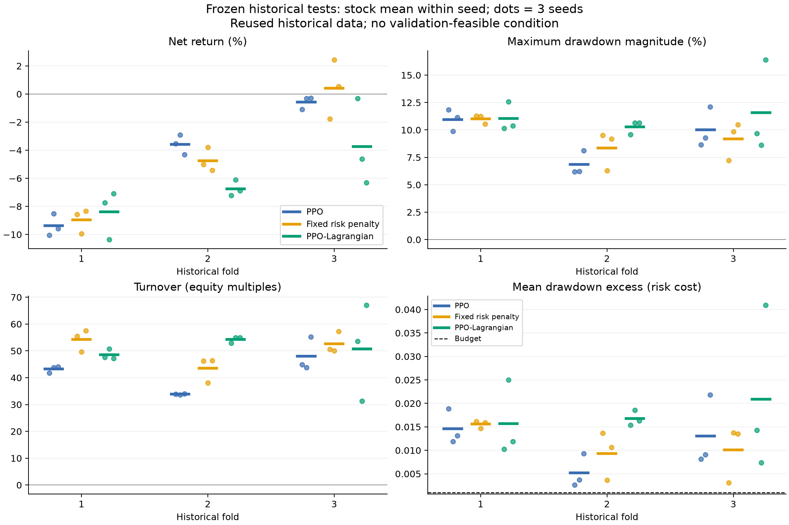

# RL 주식 트레이딩 프로젝트

실제 주가 데이터를 이용해서 PPO로 매매 정책을 학습해보는 팀 프로젝트입니다.
Python 쪽에서 강화학습과 평가를 진행하고, Java 쪽에서는 모델의 행동을 받아 모의 실행하는 구조로 만들었습니다.

처음에는 PPO로 매매를 학습시키는 것부터 시작했는데, 현금만 보유하거나 거래를 너무 자주 하는 문제가 있어서
거래비용, 행동 방식, 보상 설정을 바꿔가며 비교하고 있습니다.
아직 안정적으로 수익을 내는 모델을 만든 상태는 아닙니다.

## 지금 구현한 것

- 국내 주식 5종목 데이터를 이용한 학습 환경
- 최근 12개 봉과 계좌 상태를 관측으로 사용
- 투자 비중을 0%, 20%, 40%, 60%, 80%, 100% 중에서 선택
- 수수료, 슬리피지 등을 반영한 주문 및 체결 처리
- 기본 PPO, 고정 위험 페널티, PPO-Lagrangian 비교
- 거래비용 배율, 거래 주기, 비중 조정 폭을 바꾸는 실험
- Python과 Java의 현금·보유 수량이 맞는지 확인하는 모의 실행

미래 가격을 보고 주문 수량을 정하지 않도록 했고, 정규화도 학습 구간의 데이터만 사용합니다.
자세한 환경 설정은 [여기](docs/research-contract.md)에 정리해두었습니다.

## 실험

3개 기간과 3개 시드에서 각 방법을 비교했습니다. 수익률뿐 아니라 낙폭, 거래량, 비용도 같이 확인했습니다.



현재 결과에서는 위험 페널티를 넣었다고 항상 좋아지지는 않았습니다.
일부 기간에서는 개선됐지만, 모든 조건에서 위험 예산을 만족하지는 못했습니다.
왜 이런 차이가 생기는지 정책의 행동과 가치함수 학습 결과도 확인하고 있습니다.

과거 데이터를 여러 번 사용한 점과 데이터가 부족한 날짜를 제외한 점이 있어서,
이 결과만으로 새로운 시장에서도 잘 된다고 보기는 어렵습니다.

- [기간별 결과 CSV](docs/research-assets/frozen_test_summary.csv)
- [시드별 비교 CSV](docs/research-assets/paired_seed_differences.csv)
- [공백이 있는 시장 구간의 추가 평가](docs/research-assets/stress_comparison.png)

## 실행 방법

Linux, Python 3.11, PyTorch CPU 환경에서 확인했습니다.

```bash
git clone https://github.com/An-Choi/real_market_rl_trader.git
cd real_market_rl_trader

python3.11 -m venv .venv
source .venv/bin/activate
python -m pip install --extra-index-url https://download.pytorch.org/whl/cpu \
  -r requirements-research.lock.txt

python -m pytest -q env/tests agent/tests serving/tests
```

별도 폴더에서 Python 테스트 622개가 통과한 것을 확인했습니다.
테스트에는 KIS 키나 원본 시세가 필요하지 않습니다. 실제 데이터로 학습하려면 데이터를 따로 준비해야 합니다.
다른 환경이나 GPU에서는 아직 동일하게 검증하지 못했습니다.

학습과 모델 재생 방법은 [실행 안내](docs/reproduce.md)를 참고하면 됩니다.
전체 모델과 실험 로그는 용량 때문에 Git에 포함하지 않았고, 비교용 그래프와 집계표만 올려두었습니다.

## 폴더 구성

```text
env/          # 시장 환경, 데이터 처리, 거래비용
agent/        # PPO와 위험 제약 관련 코드
experiments/  # 학습과 비교 실험
evaluation/   # 평가 지표
serving/      # 연구 모델 재생 API
scripts/      # 데이터 확인, 진단 도구
docs/         # 실행 안내와 결과 그림
```

## 관련 저장소

- [rl-trading-core](https://github.com/An-Choi/rl-trading-core): Java 모의 실행 및 잔고 검증
- [rl_trader_data](https://github.com/An-Choi/rl_trader_data): KIS OHLCV 데이터

연구용 Java 연동은 실제 주문을 보내지 않습니다.
KIS 키와 토큰은 Git에서 제외하고 로컬에서만 사용합니다.

## 남은 부분

- 데이터 공백이 실제 거래 중단인지 수집 누락인지 더 확인하기
- 위험 제약을 넣었을 때 학습이 잘 안 되는 원인 분석하기
- 사전에 남겨둔 새 기간의 데이터로 평가하기

미래 평가 구간은 2026-11-10부터 2026-12-07까지로 정해두었습니다.
데이터가 모인 뒤 고정된 모델로 평가할 예정입니다.

이 README는 현재까지 진행한 내용을 간단히 정리한 것이고, 세부 설정과 한계는
[연구 실행 계약](docs/research-contract.md)과 [결과 출처](docs/research-assets/provenance.json)에 남겨두었습니다.
